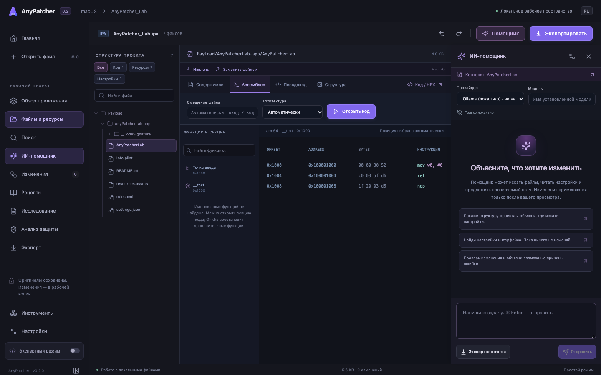

# Как пользоваться AnyPatcher

## Установка

1. Откройте [Releases](https://github.com/ANAYSSA/AnyPatcher-Releases/releases).
2. Выберите `macOS_arm64.dmg` для Mac с Apple Silicon (M1 и новее). Начиная с 0.2.4 версии для Intel не выпускаются. Тип процессора указан в меню Apple → «Об этом Mac».
3. Откройте DMG и перенесите AnyPatcher в «Программы».
4. При блокировке macOS сначала убедитесь, что файл скачан из этого репозитория. Для этой сборки можно разрешить запуск в «Системные настройки → Конфиденциальность и безопасность → Всё равно открыть». Глобально отключать Gatekeeper не нужно.

У версии 0.2 нет Apple Developer ID и нотарификации. Файл `SHA256SUMS` в релизе позволяет сравнить контрольную сумму скачанного DMG командой `shasum -a 256 путь/к/файлу.dmg`.

## Первое знакомство: без своей игры

1. На главной нажмите **Открыть учебный проект**. Это небольшой архив, сделанный специально для обучения, а не устанавливаемая игра.
2. В разделе **Файлы и ресурсы** откройте `Payload/AnyPatcherLab.app/settings.json`.
3. Измените `timeout` с `5` на `10` и нажмите **Проверить изменение**.
4. Проверьте «до» и «после», затем нажмите **Применить к копии**.
5. В разделе **Изменения** попробуйте **Отменить** и **Повторить**.
6. Откройте `resources.assets`, перейдите во вкладку **Unity**, нажмите **Прочитать ресурсы**, выберите TextAsset `settings`, измените значение и примените план. Программа повторно читает Unity-файл и проверяет, что другие объекты сохранились.
7. В разделе **Экспорт** запустите проверку и сохраните новый IPA. Оригинал остаётся прежним.

Каждый патч привязан к версии файла. Если исходные байты или SHA-256 изменились, старый план нужно создать заново.

## Свой IPA или APK и ресурсы Unity

1. Импортируйте копию своего IPA или APK. На большом приложении создание проекта займёт больше времени: сохраняется исходник, вычисляются суммы и читается содержимое.
2. Паспорт проекта показывает основной бинарник, архитектуры и распознанные технологии. Поиск по именам поможет найти `resources.assets`, `.bundle`, XML и другие файлы. Обычный поиск ищет доступные байты; внутри сжатых или зашифрованных ресурсов сначала нужен соответствующий просмотр.
3. Откройте Unity-файл, перейдите на вкладку **Unity**, нажмите **Прочитать ресурсы** и найдите TextAsset через поле **Имя, тип или ID…** и кнопку поиска или Enter. Поиск проверяет весь контейнер, включая объекты за пределами текущей страницы. Запрос, результаты и выбранный объект сохраняются при переключении разделов в текущем сеансе. Имена и номера зависят от версии игры — нельзя считать одинаковыми две разные сборки.
4. Если текст имеет вид Base64 или шифротекста, раскройте **Декодирование ресурса** и выберите подходящий кодек. Для **AES-CBC + Base64** нужны известные ключ и IV в Base64. AnyPatcher не угадывает их. После успешной проверки метод сохраняется в проекте, а ключ и IV — в Связке ключей macOS. В переносимые рецепты эти параметры не включаются.
5. Нажмите **Прочитать с кодеком**, измените доступный текст, затем **Проверить изменение** и **Применить к копии**. При сохранении данные кодируются обратно; остальные Unity-объекты проверяются.
6. Начните с одного небольшого изменения. Экспортируйте отдельный файл, подпишите и установите совместимым инструментом. Для APK используйте мастерскую сборки, для IPA — панель подписи с собственными сертификатом и профилями. Требования описаны в [инструкции по сборке](BUILDS.md).
7. Проверяйте изменённую функцию в приложении. Успешный экспорт подтверждает целостность контейнера, но не правильность поведения.

Удачные изменения можно сохранить как рецепт; он воспроизводится на **том же исходном файле**, а для другой версии требует повторного исследования. Общий интерфейс подходит для разных приложений. Если поддерживается профиль конкретного приложения, его подсказки появляются только в соответствующем проекте после распознавания идентификатора пакета.

## Найти место внутри открытого текста

Начиная с 0.2.2 над текстом файла и Unity TextAsset есть отдельная строка **Найти в тексте…**. Поиск слева выбирает файл или объект, а эта строка ищет внутри открытого текста, в том числе после декодирования.

1. Нажмите **⌘F** (на другой клавиатуре — **Ctrl+F**) или нажмите поле поиска над редактором.
2. Введите имя настройки, приёма или фрагмент XML. Поиск буквальный: кавычки, точки и скобки не являются регулярным выражением.
3. Редактор выделит найденный фрагмент и прокрутит к нему. Счётчик показывает номер выбранного совпадения и общее количество. **Enter** / стрелка вниз — следующее, **Shift+Enter** / стрелка вверх — предыдущее; доступны также **⌘G / Ctrl+G** и вариант с Shift.
4. **Aa** включает точное совпадение регистра. **Esc** из поля поиска возвращает курсор к выделенному фрагменту, чтобы его можно было редактировать.
5. Запрос и регистр сохраняются отдельно для каждого документа в текущем сеансе. Поиск не меняет содержимое и не применяет патч. Изменения текста по-прежнему нужно проверить и применить.

Для большого обычного файла поиск охватывает показанный фрагмент, если редактор сообщает об ограниченном предпросмотре. Для TextAsset поиск работает по полному загруженному тексту.

## Ассемблер и псевдокод

Откройте основной исполняемый файл из паспорта проекта или библиотеку Mach-O/ELF/PE. Вкладки **Структура**, **Ассемблер**, **Псевдокод** доступны в обычном режиме. Unity показывается только для подходящих контейнеров.

1. Нажмите **Открыть код**, оставив смещение пустым. Программа выбирает вход в код или функцию из таблицы бинарника. Смещение `0` вручную означает начало файла, где часто находится заголовок.
2. Выбирайте функции и исполняемые секции в списке для перехода по коду. Для FAT Mach-O можно выбрать архитектуру.
3. Для псевдокода установите полную Ghidra и JDK, укажите `support/analyzeHeadless` и Java в **Инструментах**. Затем откройте **Псевдокод** и запустите анализ нужной функции. Первый анализ большой программы может занимать минуты; результат кэшируется по версии файла.
4. HEX доступен через экспертный режим. Он нужен для точной замены байт; адрес в памяти и смещение в файле различаются.

При зашифрованном Mach-O программа сообщает ограничение. Псевдокод не равен исходникам и может содержать неточные имена/типы.

## APK, наборы и подпись

В **APK-мастерской** сначала декодируйте APK. Редактируйте Manifest, ресурсы и Smali через проверяемые планы. Это отдельный снимок с собственной историей: если исходные файлы проекта менялись, обновите разбор осознанно. Сборка использует выбранный keystore, проверяет выравнивание и подпись готовой копии.

Для XAPK/APKM/APKS откройте нужный APK из таблицы комплекта. Объединение ZIP-файлов не превращает сплиты в самостоятельное приложение. Для AAB доступны режимы bundletool `universal` и `default` с подписью выбранным ключом.

Панель Android-устройства работает через отдельно установленный ADB. Сканирование, импорт, установка и запуск выполняются только по нажатию. В этой версии нет управления iPhone. [Подробная инструкция по подписи APK, IPA и PE](BUILDS.md).

## Локальный ИИ без лимитов облачного сервиса

1. Пока есть интернет, установите [Ollama](https://ollama.com/download/mac).
2. Загрузите модель, которая поддерживает вызовы инструментов и помещается в память вашего Mac. Модель не входит в DMG.
3. В **Настройках → ИИ-модели** выберите Ollama и локальный адрес `http://127.0.0.1:11434`, затем нажмите **Сохранить**. Нажмите **Список моделей**, выберите загруженную модель в поле **Модель** и снова сохраните. Список запрашивается с уже сохранённого адреса.
4. Оставьте включённым переключатель **Только локальные модели** и сохраните настройку. Откройте **Инструменты → Без интернета**, чтобы проверить готовность до отключения сети.
5. Откройте боковую панель **ИИ-помощник** и сформулируйте конкретную задачу, например: «Найди настройку timeout в учебном проекте и предложи увеличить её до 10».
6. Помощник читает проект и предлагает план. Вы самостоятельно проверяете и применяете его.

Качество ответа зависит от модели; локальная модель не гарантирует уровень облачных моделей. Помощник не управляет телефоном и не выполняет произвольные shell-команды. Он не применяет патчи скрыто.

Для облачного ИИ можно войти в аккаунт ChatGPT через Codex либо указать API-ключ выбранного провайдера. Перед запуском требуется согласие на передачу запроса и фрагментов выбранного проекта. Полный архив автоматически не отправляется. Подробности — в [инструкции по интеграциям](INTEGRATIONS.md).

## Если что-то пошло не так

- **Операция долгая:** смотрите прогресс; отмена останавливает анализатор. Оригинал сохраняется.
- **Текст слишком большой:** редактор показывает ограничение; нельзя заменять полный файл неполным предпросмотром.
- **Патч перестал подходить:** изменились исходные байты. Перечитайте файл и создайте новый план.
- **Нет Ghidra или JADX:** установите инструмент отдельно и откройте **Инструменты → Анализаторы → Указать путь** и выберите его исполняемый файл.
- **Изменённое приложение зависает:** отмените последнее изменение и сравните поведение. Импорт текстового журнала даёт подсказки, а не гарантированный диагноз.
- **Нужно освободить место:** откройте **Инструменты → Место на диске → Очистить кэш**; удалятся восстановимые временные данные. Проекты и история сохраняются отдельно.

Проекты хранятся в `~/Library/Application Support/io.github.anayssa.anypatcher/projects`. Не редактируйте вручную SQLite и папки снимков. Для переноса результата используйте экспорт и рецепты.

## 0.2.3: аккаунт ChatGPT и сохранённое декодирование

В «Настройки → ИИ-модели» выберите **ChatGPT через Codex → Войти в ChatGPT**, завершите вход в браузере и выберите модель из загруженного списка. Google можно выбрать на странице входа, если он там доступен. В помощнике справа также появится выбор модели. Вход использует лимиты аккаунта; облачный запрос требует отдельного подтверждения в панели.

Для ресурса Unity: выберите TextAsset → **Определить формат**. Если этого недостаточно, нажмите **Исследовать расшифровку с ИИ**, проверьте запрос и отправьте его. Помощник может изучить загрузчик и проверить найденный способ. Успешный результат откройте кнопкой **Открыть и сохранить способ**.

Если параметры уже известны, укажите их в «Декодирование ресурса» и нажмите **Прочитать с кодеком**. После успешной проверки они сохранятся автоматически: метод — в проекте, ключ и IV — в Связке ключей macOS. При следующем открытии объекта, в том числе после перезапуска приложения, вводить их снова не нужно. Для сброса есть **Забыть способ**.

Сохранение относится к выбранному ресурсу: другой TextAsset может иметь другой ключ. Если файл заменён и сохранённый метод больше не подходит, приложение покажет исходные данные и предупреждение. Автоматическое исследование не гарантирует нахождение неизвестного или серверного ключа.

Поиск внутри редактора доступен для всего читаемого текста, включая XML, JSON, Smali и декодированные TextAsset. Нажмите **⌘F**, введите текст, переходите **Enter / Shift+Enter**. Поиск не меняет содержимое. После редактирования используйте **Проверить изменение → Применить → Экспорт**; ресурс кодируется обратно тем же способом.

## 0.2.5: файлы внутри Dzip и исследование загрузчика

Если APK содержит `files.dz`, откройте его во вкладке **Архив ресурсов** (Dzip). Поиск здесь ищет имена всех вложений. Например, в некоторых APK ресурс `moves.xml` находится в `assets/animations/moves.xml` внутри контейнера, а не отдельным файлом APK.

1. Найдите нужное вложение и нажмите его имя. Derbh распаковывается встроенным отдельным Dzip CLI; ключ AES для этого сжатия не нужен.
2. Используйте **Найти в тексте…** или ⌘F в открывшемся редакторе.
3. Измените текст, нажмите **Проверить изменение**, просмотрите план и примените его к копии.
4. Экспортируйте APK и подпишите выбранным Android keystore. Вложение записывается поддерживаемым методом copy, поэтому контейнер может стать больше. Другие сжатые блоки сохраняются побайтно. Изменения поведения нужно проверить в приложении.

Поддерживается однопакетный DTRZ; многотомные архивы и редактирование связанных COMBUF-блоков пока недоступны. Чтение ограничено 128 МиБ распакованного контейнера, 16 МиБ на вложение; редактор загружает до 8 МиБ и запрещает сохранение неполного предпросмотра.

Для нативного кода появился список **Функции / IL2CPP / Строки / Ссылки**. Выберите функцию или метод, чтобы перейти к его ассемблеру или псевдокоду. Ссылка на адрес показывает возможного вызывающего; это результат статического анализа, а не доказательство выполнения. Указание конкретной функции не подменяется просмотром первых функций библиотеки.

Помощник теперь начинает исследование ресурса с проверки сохранённого способа. При новом исследовании ему доступны связь методов IL2CPP с нативным кодом, входящие ссылки и чтение статических полей через метаданные. Он подтверждает расшифровку чтением и обратным кодированием; неизвестная версия метаданных или ключ с сервера остаются ограничениями. Поиск больших бинарников показывает охват и продолжение, если установленный предел достигнут.

## 0.2.6: продолжить исследование и добавить блок

Помощник сохраняет журнал исследования в проекте. Можно написать «Продолжи с последнего найденного адреса, используй журнал»; результаты для изменившихся файлов автоматически исключаются. Проверенный способ декодирования сохраняется отдельно.

Для нового XML-блока: «Найди подходящий существующий элемент, прочитай его целиком, клонируй под новым именем и предложи один план с нужными изменениями». Для вставки в текстовый файл укажите уникальный текст, перед которым или после которого нужен новый фрагмент. Изучите сравнение, затем примените план и экспортируйте отдельную копию.

Экономный бюджет включён по умолчанию. Если исследование сложное, можно выбрать расширенный; оба режима расходуют лимит провайдера. При остановке журнал позволяет продолжать с полученных доказательств. Успешный поиск произвольного шифра или команд неизвестного приложения не гарантируется.
